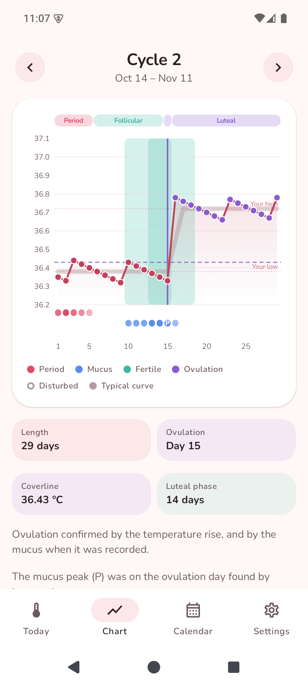
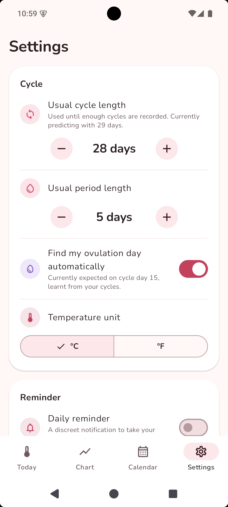

<div align="center">


# Ondea

**Private, offline fertility and ovulation tracker for Android, based on basal body temperature and cervical mucus.**

[](https://github.com/0x0SegFault/ondea/actions/workflows/build.yml)
[](https://github.com/0x0SegFault/ondea/releases/latest)
[](https://github.com/0x0SegFault/ondea/releases)
[](LICENSE)
[](#get-the-app)
[](#privacy)

English · Français · Deutsch · Español · Italiano

</div>

Ondea helps you find your fertile days and confirm ovulation when you try to conceive. Each morning, you log your temperature. You can also log your period, cervical mucus and ovulation tests. Ondea uses the symptothermal method and published studies to show your fertile window, your most fertile days and your chance of conception per day.

Ondea has no internet access, no account, no ads and no tracking. It works without Google Play Services.

> **Ondea is not a contraceptive and not a medical device.**

<p align="center">
  
  
  
  
  
</p>

## Get the app

| Source | How |
|---|---|
| [Obtainium](https://github.com/ImranR98/Obtainium) (recommended) | Add `https://github.com/0x0SegFault/ondea`. You get updates automatically. |
| [GitHub Releases](https://github.com/0x0SegFault/ondea/releases/latest) | Download `ondea-X.Y.Z.apk` on your phone and open it. |
| F-Droid | Planned for early 2027. F-Droid accepts apps after 3 months of development. |

Updates install over the previous version and keep your data. Each release includes a `.sha256` file to check the download.

## Features

- **Fast daily entry:** waking temperature with +/− buttons. Period, cervical mucus, ovulation test (LH), intercourse and notes save when you tap them.
- **Ovulation confirmed** by the temperature rise (3-over-6 rule) and the cervical mucus peak.
- **Fertile window and peak days**, predicted from your own cycles and corrected by the signs you log.
- **Chance of conception per day** (Wilcox et al., *NEJM* 1995).
- **Your usual ovulation day and Ondea's estimate**, both kept. You choose which one predicts.
- **"How this date is set":** tap the date source to see each sign and which one is in use.
- **Cycle ring, temperature chart and calendar.** Tap a past day to add or correct it.
- **Next period forecast**, late-period notice, and a pregnancy hint after 18 days of high temperature.
- Discreet daily reminder, °C or °F, 5 languages.

## How it works

Ondea combines the signs of your cycle, strongest first:

| Sign | When it appears | What Ondea does |
|---|---|---|
| Temperature rise | **After** ovulation | Confirms ovulation. Teaches Ondea your ovulation day for the next cycles. |
| Ovulation test (LH) | 22–56 h **before** ovulation | Sets ovulation to the day after the first positive test. |
| Cervical mucus | Days **before** ovulation | Opens the fertile window. The peak day estimates ovulation. |
| Prediction | Before any sign | Uses your past confirmed cycles, your usual day, or a typical cycle. |

The temperature rise cannot announce ovulation: when it is confirmed, the fertile days of that cycle have passed. It makes the next predictions better. To time intercourse in the current cycle, use mucus and ovulation tests.

Each rule and its scientific source: [docs/SCIENCE.md](docs/SCIENCE.md). The app shows the same sources in **Settings → About → Science and sources**.

## Privacy

- **No internet permission.** The app cannot send data. CI fails if the permission ever appears.
- **Encrypted on the phone** with AES-256-GCM. The key stays in the Android Keystore.
- **Not in Android cloud backups.** No account, no ads, no analytics, no Google services.
- **Optional app lock** (fingerprint, face or screen lock) and screenshot blocking.
- **Backups only when you ask**, encrypted with your password. Send them to Proton Drive, Nextcloud or another app, or save them as a file.

| Permission | Why |
|---|---|
| Notifications | Daily reminder. Asked only when you turn it on. |
| Run at startup | Sets the reminder again after a restart. |
| Fingerprint and face | App lock. Ondea never sees your fingerprint or face. |

No internet, location, contacts, camera, microphone, storage or accounts. Full list and data label: [PRIVACY.md](PRIVACY.md). Security: [SECURITY.md](SECURITY.md).

## Build from source

You need JDK 17 or newer and the Android SDK (platform 36).

```sh
git clone https://github.com/0x0SegFault/ondea.git
cd ondea
./gradlew testDebugUnitTest   # unit tests
./gradlew lintDebug           # Android lint
./gradlew assembleDebug       # app/build/outputs/apk/debug/app-debug.apk
```

| Folder | Contents |
|---|---|
| [`shared/`](shared) | Fertility logic and data format in Kotlin Multiplatform: shared by Android and the planned iOS app. Tests: `./gradlew :shared:jvmTest` |
| [`app/`](app) | Android app: screens, encrypted storage, reminder, backups |

Release builds are reproducible.

## Contribute

Bug reports, translations and pull requests are welcome. To translate, see [docs/TRANSLATING.md](docs/TRANSLATING.md). Read [CONTRIBUTING.md](CONTRIBUTING.md) first. Report security issues privately: [SECURITY.md](SECURITY.md).

Maintainers: [docs/RELEASING.md](docs/RELEASING.md) explains releases, signing and F-Droid.

## How Ondea is made

Ondea is AI-assisted. The code was written with an AI coding assistant. The maintainer sets the requirements, reviews and tests every change, and is responsible for each release.

## License

[GPL-3.0-or-later](LICENSE). The bundled Nunito font uses the [SIL Open Font License 1.1](LICENSE-font-Nunito.txt).
