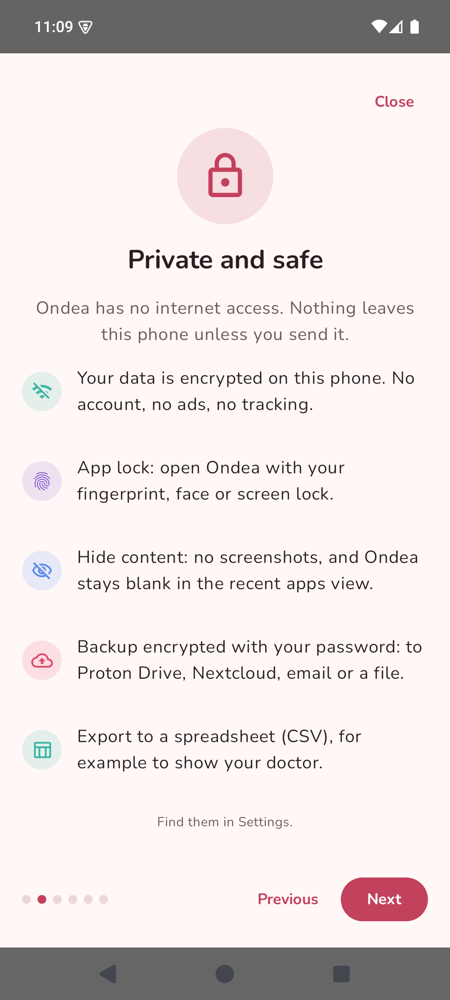

<div align="center">


# Ondea

**Private, offline period and ovulation tracker for Android and iPhone, based on basal body temperature and cervical mucus.**

[](https://github.com/0x0SegFault/Ondea/actions/workflows/build.yml)
[](https://github.com/0x0SegFault/Ondea/actions/workflows/ios.yml)
[](https://github.com/0x0SegFault/Ondea/releases/latest)
[](https://github.com/0x0SegFault/Ondea/releases)
[](LICENSE)
[](#get-the-app)
[](ios)
[](#privacy)

English · Français · Deutsch · Español · Italiano

</div>

Ondea helps you find your fertile days and confirm ovulation when you try to conceive. Each morning, you log your temperature. You can also log your period, cervical mucus and ovulation tests. Ondea learns from your signs day by day and shows your fertile window, your most fertile days and your chance of conception per day. Each rule comes from a published study.

Ondea has no internet access, no account, no ads and no tracking. It works without Google Play Services.

| Platform | Status |
|---|---|
| Android 8.0+ | Available: [releases](https://github.com/0x0SegFault/Ondea/releases/latest), Obtainium. F-Droid, IzzyOnDroid and Google Play planned. |
| iPhone (iOS 17+) | First version: Today, daily entry, tour and app lock. Built and tested in CI on each change. Chart, calendar and backups to come; App Store later. See [ios/](ios). |

Both apps share the same fertility logic ([`shared/`](shared), Kotlin Multiplatform), the same data format and the same translations.

> **Ondea is not a medical device and does not diagnose, treat, cure or prevent any medical condition. It is not a contraceptive.** Consult a healthcare professional for medical advice.

<p align="center">
  
  
  
  
  
  
</p>

## Get the app

| Source | How |
|---|---|
| [Obtainium](https://github.com/ImranR98/Obtainium) (recommended) | Add `https://github.com/0x0SegFault/Ondea`. You get updates automatically. |
| [GitHub Releases](https://github.com/0x0SegFault/Ondea/releases/latest) | Download `ondea-X.Y.Z.apk` on your phone and open it. |
| F-Droid, IzzyOnDroid | Planned. |
| Google Play | Planned, as a period tracker. |
| iOS | In progress: see [ios/](ios). |

Updates install over the previous version and keep your data. Each release includes a `.sha256` file to check the download.

## Features

- **Fast daily entry:** waking temperature to 0.01 °C with one wheel per digit, or typed. Period, cervical mucus, ovulation test (LH), intercourse and notes save when you tap them.
- **Learns day by day:** fertile mucus or a first high temperature moves the estimate of the current cycle.
- **"Do your signs agree?":** compares the ovulation day shown by your temperature and by your mucus. If they are far apart, Ondea asks you to check for disturbed readings.
- **Ovulation confirmed** by the temperature rise (3-over-6 rule) and the cervical mucus peak.
- **One ovulation day for the forecast.** Only you change it. After a cycle, Ondea shows what your signs point to and suggests that day.
- **Chance of conception per day** (Wilcox et al., *NEJM* 1995).
- **Cycle ring, temperature chart and calendar.** The chart shows the phases, your usual low and high levels and the typical curve. Tap a past day to add or correct it.
- **Next period forecast**, late-period notice, and a pregnancy hint after 18 days of high temperature.
- **Short tour** before the setup: what Ondea is, privacy, what to record, how to measure, how to read the chart. Open it again in Settings → How Ondea works.
- Discreet daily reminder, °C or °F, 5 languages.
- **Anonymous problem reports:** a form in your browser, no account and no email. Or use GitHub.

## How it works

**Before any sign,** the forecast uses one ovulation day: the day you set, or a typical cycle (cycle length minus a 14-day luteal phase).

**During the cycle,** your signs move the estimate, strongest first:

| Sign | When it appears | What Ondea does |
|---|---|---|
| Temperature rise | **After** ovulation | Shown as "rising" from the first high reading. Confirms ovulation after 3 readings. |
| Ovulation test (LH) | 22–56 h **before** ovulation | Sets ovulation to the day after the first positive test. |
| Cervical mucus | Days **before** ovulation | Opens the fertile window. Creamy and egg-white mucus move the estimate. The peak day estimates ovulation. |
| No sign yet | After the forecast day | While you keep recording, the estimate moves later, one day at a time (10 days at most). |

**After the cycle,** Ondea learns your ovulation day, your usual temperature levels and your usual gap between mucus peak and ovulation. When what it learnt differs from your forecast day by 2 days or more, it suggests the new day. You choose.

The temperature rise cannot announce ovulation: when it is confirmed, the fertile days of that cycle have passed. To time intercourse in the current cycle, use mucus and ovulation tests.

Each rule and its scientific source: [docs/SCIENCE.md](docs/SCIENCE.md). The app shows the same sources in **Settings → About → Science and sources**.

## Privacy

- **No internet permission.** The app cannot send data. CI fails if the permission ever appears.
- **Encrypted on the phone** with AES-256-GCM. The key stays in the Android Keystore (on iPhone: in the Keychain, this device only).
- **Not in cloud backups** (Android backup, iCloud). No account, no ads, no analytics, no Google services.
- **Optional app lock** (fingerprint, face, Face ID or screen lock) and screenshot blocking on Android.
- **Backups only when you ask**, encrypted with your password. Send them to Proton Drive, Nextcloud or another app, or save them as a file. Export to a spreadsheet (CSV) is also possible.
- **Problem reports** open a form in your browser. You see the full text before you send it. The form keeps nothing about you (no IP address, no cookie).

| Permission | Why |
|---|---|
| Notifications | Daily reminder. Asked only when you turn it on. |
| Run at startup | Sets the reminder again after a restart. |
| Fingerprint and face | App lock. Ondea never sees your fingerprint or face. |

No internet, location, contacts, camera, microphone, storage or accounts. Full list and data label: [PRIVACY.md](PRIVACY.md). Security: [SECURITY.md](SECURITY.md).

## Build from source

You need JDK 17 or newer and the Android SDK (platform 36).

```sh
git clone https://github.com/0x0SegFault/Ondea.git
cd Ondea
./gradlew testDebugUnitTest   # unit tests
./gradlew lintDebug           # Android lint
./gradlew assembleDebug       # app/build/outputs/apk/debug/app-debug.apk
```

| Folder | Contents |
|---|---|
| [`shared/`](shared) | Fertility logic and data format in Kotlin Multiplatform, shared by Android and iOS. Tests: `./gradlew :shared:jvmTest` |
| [`app/`](app) | Android app: screens, encrypted storage, reminder, backups |
| [`ios/`](ios) | iOS app (SwiftUI, first version) |
| [`reports/`](reports) | Anonymous report form (Scaleway function, Paris) |

Release builds are reproducible.

## Contribute

Bug reports, translations and pull requests are welcome. To translate, see [docs/TRANSLATING.md](docs/TRANSLATING.md). Read [CONTRIBUTING.md](CONTRIBUTING.md) first. Report security issues privately: [SECURITY.md](SECURITY.md).

Maintainers: [docs/RELEASING.md](docs/RELEASING.md) explains releases, signing and F-Droid; [docs/STORES.md](docs/STORES.md) explains Google Play (personal account, period tracker) and the App Store.

## How Ondea is made

Ondea is AI-assisted. The code was written with an AI coding assistant. The maintainer sets the requirements, reviews and tests every change, and is responsible for each release.

## License

[EUPL-1.2](LICENSE), the open-source licence of the European Union. The bundled Nunito font uses the [SIL Open Font License 1.1](LICENSE-font-Nunito.txt).
