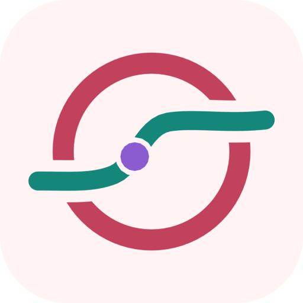
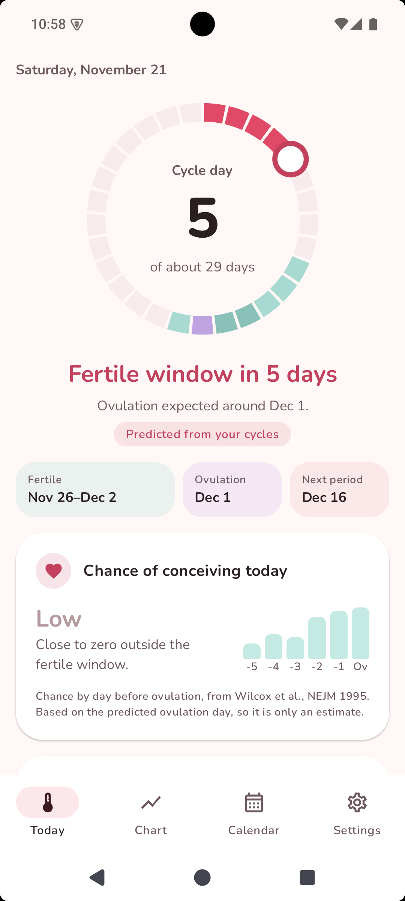
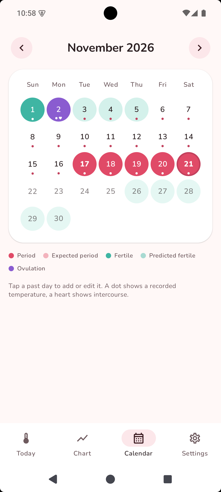
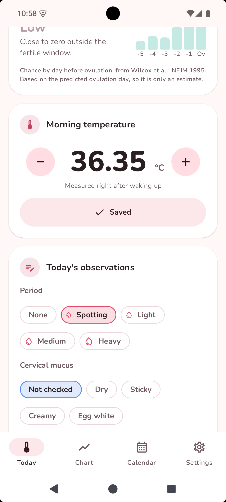

<div align="center">



# Ondea

**Private, offline fertility and ovulation tracker for Android, based on basal body temperature and cervical mucus.**

[](https://github.com/0x0SegFault/ondea/actions/workflows/build.yml)
[](LICENSE)
[](#install)
[](#privacy-and-security)
[](https://github.com/0x0SegFault/ondea/releases)

English · Français · Deutsch · Español · Italiano

</div>

**Ondea** is a free and open-source (FOSS) Android app that helps you find your fertile days and confirm ovulation when trying to conceive. Log your basal body temperature (BBT) each morning, plus cervical mucus and your period. Ondea applies the **symptothermal method** (the 3-over-6 temperature rule and the cervical mucus double check) and shows your chance of conceiving by day, based on Wilcox et al. (*NEJM* 1995).

It has **no internet permission, no account, no ads and no analytics**, and it works on de-Googled phones (LineageOS, GrapheneOS, /e/OS, CalyxOS). **Ondea is not a contraceptive.**

<p align="center">
  
  
  
  
  
</p>

## Features

- **Quick daily entry:** your waking temperature with big +/− buttons, plus period flow, cervical mucus, intercourse and a note. Observations save as soon as you tap them.
- **Ovulation confirmation** from your temperature (3-over-6 rule) and your cervical mucus (peak day), as in the symptothermal method.
- **Fertile window and peak days**, predicted from your own cycles until your body confirms them.
- **Chance of conceiving today**, by day relative to ovulation (Wilcox et al., *NEJM* 1995).
- **Next period forecast**, a late-period notice, and a pregnancy hint after 18+ days of high temperatures.
- **Cycle ring, temperature chart and calendar.** Tap any past day to fill it in or correct it.
- **Your usual ovulation day** can be set manually (for example from ovulation tests), or learnt automatically.
- **Start a new cycle or pause tracking** at any time.
- **Discreet daily reminder**, °C or °F, 5 languages.

## Install

| Source | Status |
|---|---|
| [GitHub Releases](https://github.com/0x0SegFault/ondea/releases) | Signed APK attached to each release |
| [Obtainium](https://github.com/ImranR98/Obtainium) | Add `https://github.com/0x0SegFault/ondea` to get automatic updates from GitHub |
| F-Droid | Submission in progress |

## Privacy and security

| | |
|---|---|
| Network | **No `INTERNET` permission.** The manifest explicitly removes it, and CI fails if it ever appears. |
| Accounts, ads, analytics | None. |
| Google Play Services | Not used: no Google or Firebase dependencies. |
| Storage | One app-private file encrypted with **AES-256-GCM**. The key is generated inside the **Android Keystore** (StrongBox when available) and can never be exported. |
| Android cloud backup | Disabled (`allowBackup=false`, plus data-extraction rules that exclude everything). |
| App lock | Optional: fingerprint, face or screen lock (framework BiometricPrompt). |
| Screenshots | Blocked by default; content hidden in recent apps. |
| Backups | Created only by you, encrypted with your password (PBKDF2-HMAC-SHA256, 600,000 iterations, AES-256-GCM). |

See [PRIVACY.md](PRIVACY.md) and [SECURITY.md](SECURITY.md).

### Backups and Proton Drive

**Settings → Backup → Create encrypted backup** asks for a password, then opens the Android file picker. Save the file on the phone, on an SD card, or in any cloud app that appears in the picker (Proton Drive, Nextcloud…). If your cloud app doesn't appear, save the file to the phone and upload it with that app. The file is encrypted before it leaves Ondea, so the provider can't read it.

## How it works

After ovulation, progesterone raises the resting temperature by about 0.2–0.5 °C until the next period. Ondea combines three signs, strongest first:

1. **Temperature (3-over-6 rule).** The *coverline* is the highest of the 6 valid readings before a given day. When 3 consecutive readings are above it and the 3rd is at least **0.2 °C** higher, ovulation is confirmed. If the 3rd is less than 0.2 °C higher, a 4th reading above the coverline is needed. Ovulation is estimated as the day before the first high reading. Readings marked *disturbed* (illness, alcohol, short night, late measurement) are ignored.
2. **Cervical mucus (double check).** The first sticky or wetter mucus opens the fertile window. The *peak day* is the last day of the best-quality mucus, recognised once the quality drops; ovulation usually happens within a day of it. The fertile phase ends only when **both** the temperature rise is confirmed **and** 3 days have passed since the peak.
3. **Prediction.** Before any sign, ovulation is predicted on your usual ovulation day (if set), or at *average cycle length − luteal phase*. The average uses your last 6 complete cycles, and the luteal phase is learnt from cycles with a confirmed rise (14 days by default). The fertile window covers the 5 days before ovulation, ovulation day and the day after; the **peak days** are the 2 days before ovulation and ovulation day.

The algorithm is plain Kotlin in [`app/src/main/java/app/ondea/domain/`](app/src/main/java/app/ondea/domain) and is fully unit-tested.

### References

- Frank-Herrmann P. et al. *The effectiveness of a fertility awareness based method to avoid pregnancy in relation to a couple's sexual behaviour during the fertile time.* Human Reproduction, 2007.
- Wilcox A.J., Weinberg C.R., Baird D.D. *Timing of sexual intercourse in relation to ovulation.* N Engl J Med, 1995;333:1517–21.
- Arbeitsgruppe NFP. *Natürlich und sicher* (Sensiplan reference handbook).

> **Disclaimer:** Ondea helps you understand your cycle and find your most fertile days. It is **not a medical device** and **not a contraceptive**. Ask a health professional for medical advice.

## Development

Requirements: JDK 17+ and the Android SDK (platform 35).

```sh
git clone https://github.com/0x0SegFault/ondea.git
cd ondea
./gradlew testDebugUnitTest   # unit tests
./gradlew lintDebug           # Android lint
./gradlew assembleDebug       # app/build/outputs/apk/debug/app-debug.apk
```

### Tests

Every push and pull request runs the unit tests, lint, a release build and a check that the APK has no internet permission ([see the workflow](.github/workflows/build.yml)).

| Test suite | What it covers |
|---|---|
| `ShiftDetectorTest` | 3-over-6 rule, the 4th-reading exception, skipped and disturbed days |
| `MucusDetectorTest` | First mucus, peak day detection, peak moving when quality returns |
| `CycleEngineTest` | Predictions, learnt cycle and luteal lengths, usual ovulation day, mucus/temperature double check, late periods, pausing |
| `FertilityChanceTest` | Conception chance table (Wilcox 1995) |
| `TemperatureTest` | °C/°F conversion and input parsing |
| `BackupCryptoTest` | Backup encryption round trip, wrong password, tampering, invalid files |

### Release signing

1. Create a key once and keep it safe; losing it means you can no longer publish updates:
   ```sh
   keytool -genkeypair -v -keystore ondea-release.jks -alias ondea -keyalg RSA -keysize 4096 -validity 10000
   ```
2. Create `keystore.properties` in the project root (git-ignored):
   ```properties
   storeFile=ondea-release.jks
   storePassword=...
   keyAlias=ondea
   keyPassword=...
   ```
3. `./gradlew assembleRelease` writes the signed APK to `app/build/outputs/apk/release/`.

### Publishing on F-Droid

F-Droid builds the app from source itself and signs it with its own key.

1. Tag the release: `git tag -a v1.0.0 -m "Ondea 1.0.0" && git push origin v1.0.0`.
2. Fork [fdroiddata](https://gitlab.com/fdroid/fdroiddata) on GitLab and add [`fdroid/io.github.x0x0segfault.ondea.yml`](fdroid/io.github.x0x0segfault.ondea.yml) as `metadata/io.github.x0x0segfault.ondea.yml`.
3. Open a merge request using the "App inclusion" template. The store texts and screenshots are read from [`fastlane/metadata/android/`](fastlane/metadata/android).

For later releases, bump `versionCode` and `versionName` in `app/build.gradle.kts`, add `fastlane/metadata/android/<lang>/changelogs/<versionCode>.txt`, and push a new `vX.Y.Z` tag. F-Droid picks it up automatically.

## Contributing

Bug reports, translations and pull requests are welcome. See [CONTRIBUTING.md](CONTRIBUTING.md). Please report security issues privately ([SECURITY.md](SECURITY.md)).

## License

Ondea is licensed under the [GNU General Public License v3.0 or later](LICENSE). The bundled Nunito font is licensed under the [SIL Open Font License 1.1](LICENSE-font-Nunito.txt).
